# 🪴 FocusGrow

<p align="center">
  <br>
  <b>A lightweight, hardware-accelerated Windows desktop productivity suite featuring Dual Focus modes, real-time app &amp; website blocking, Spotify &amp; YouTube Music vinyl sync, offline procedural soundscapes, automated prayer times schedule enforcement, and productivity analytics.</b>
</p>

<p align="center">
  
  
  
  
  
  
</p>

---

## 📸 Interface Showcase

### 1. Main Dashboard & Live Distraction Guard
<p align="center">
  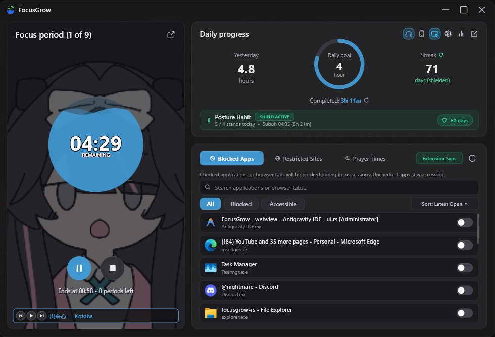
</p>
<p align="center">
  <b>Main Dashboard:</b> Pomodoro timer over progressive animated GIF backdrop, Daily Goal multi-tier lap progress &amp; Posture Habit shield, and real-time Blocked Apps &amp; Browser Tab monitor.
</p>

---

### 2. Floating PiP Mini Widget, Dynamic Capsule, Peeking Vinyl & Sprout Growth
| Standard Card PiP | Dynamic Island Capsule (Glass) | Rotating Album Art Capsule | Peeking Vinyl Companion |
| :---: | :---: | :---: | :---: |
| 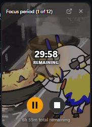 | 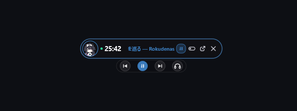 | 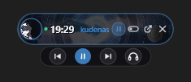 | 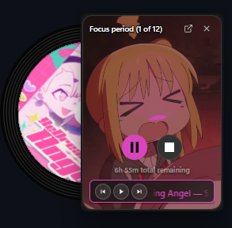 |

<p align="center">
  <i>Always-on-top Picture-in-Picture mini timer with live YouTube Music ticker, resizable Dynamic Island Capsule with rotating album art backdrop, desktop-transparent Peeking Vinyl sleeve, and vector Sprout Plant Growth mode.</i>
</p>

---

### 3. Customization, GIF Backdrop, Soundscape Mixer & Prayer Times
<p align="center">
  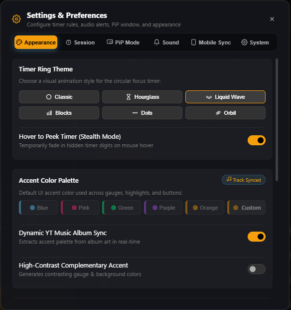
  &nbsp;
  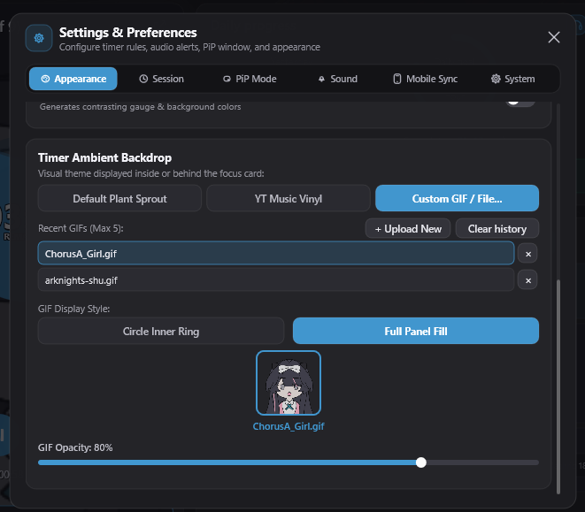
</p>
<p align="center">
  <b>Appearance &amp; GIF Controls:</b> 6 timer ring styles, Stealth click-to-hide timer with <i>Hover to Peek</i>, accent palette with high-contrast complementary extraction, and progressive Custom GIF management.
</p>

| Offline Soundscape Mixer | Prayer Schedule & Ihtiyat Offset |
| :---: | :---: |
| 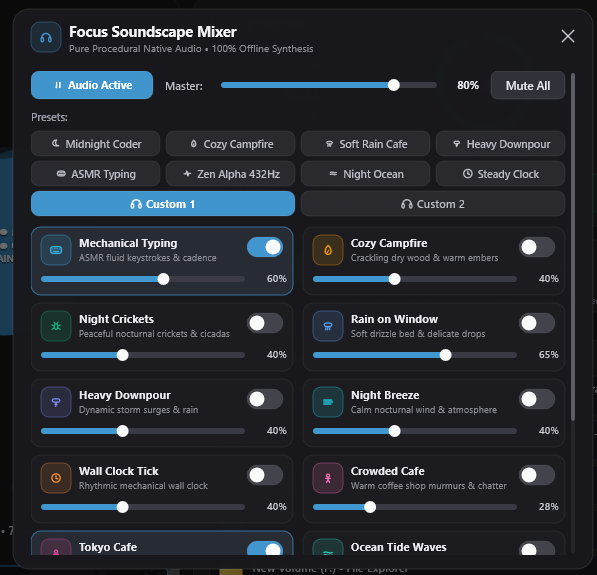 | 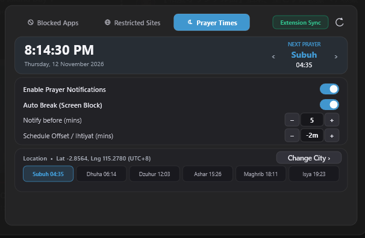 |

<p align="center">
  <b>Audio &amp; Prayer Guard:</b> 11-track offline WASAPI procedural audio mixer with 8 factory presets and auto-saving Custom Presets, alongside astronomical prayer times, Auto GPS / city search, adjustable schedule offset, and anti-bypass 15-minute screen lock.
</p>

---

### 4. Focus Analytics, Productivity Flow & Share Card
<p align="center">
  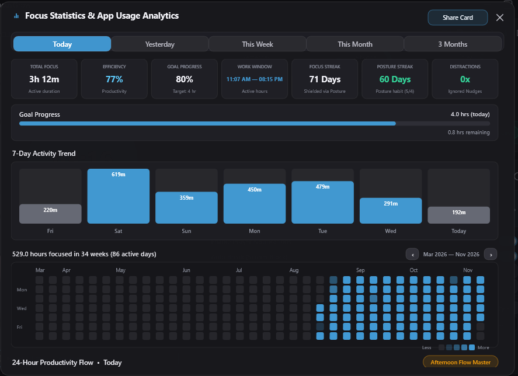
  &nbsp;
  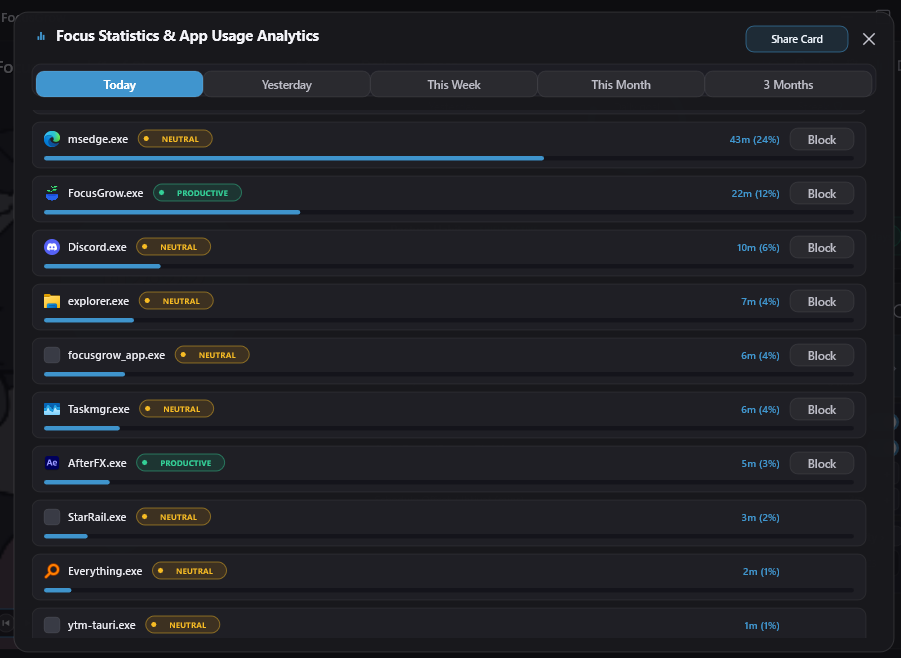
</p>
<p align="center">
  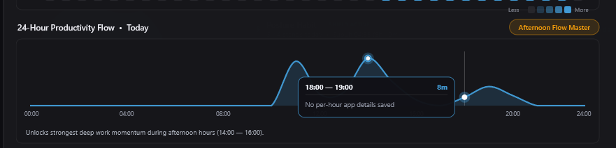
</p>
<p align="center">
  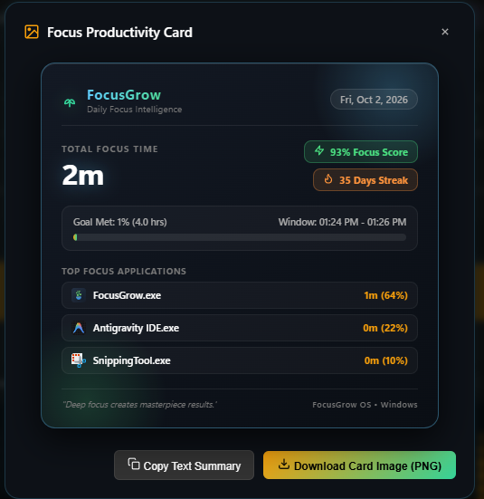
</p>
<p align="center">
  <b>Analytics &amp; Reporting:</b> Today / Yesterday / Week / Month / 3 Months periods, 34-week contribution heatmap, categorized app breakdown, 24-hour flow tooltips with app icons, and 1-click Share Card PNG / clipboard export.
</p>

---

### 5. Real-Time Blocker & Full-Screen Break Overlays
<p align="center">
  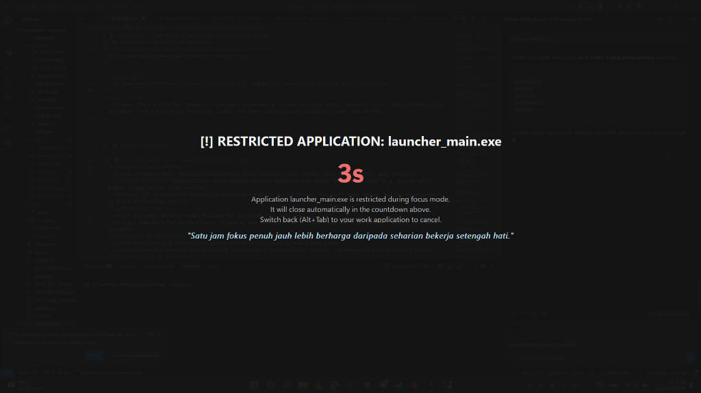
  &nbsp;
  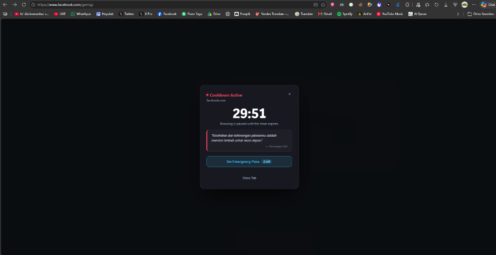
</p>
<p align="center">
  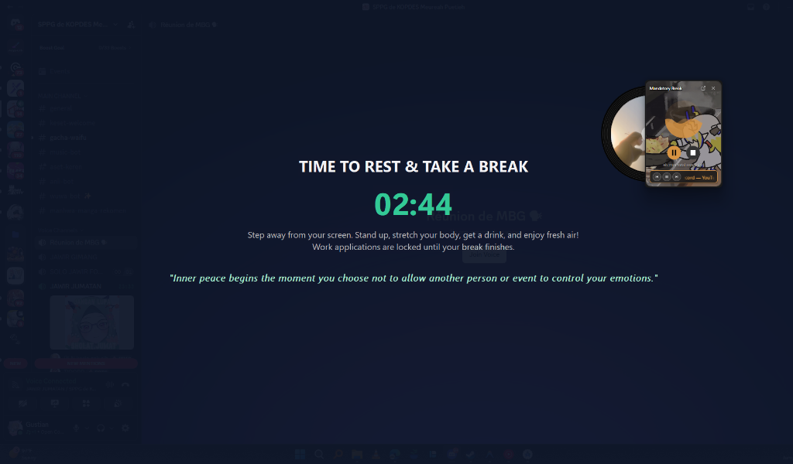
  &nbsp;
  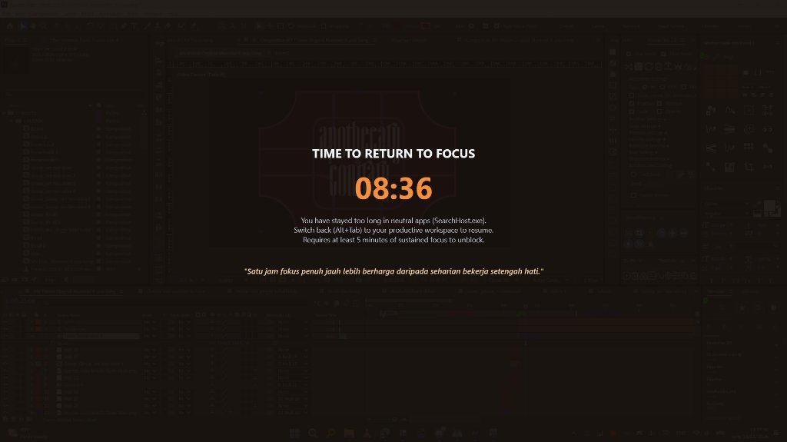
</p>
<p align="center">
  <i>Event-driven <code>SetWinEventHook</code> &amp; UI Automation distraction guard across single or all monitors, with 5-second close countdowns, neutral app overstay locks, emergency website passes, and multi-monitor rest/prayer locks.</i>
</p>

---

## ✨ Key Capabilities

### 🎯 Dual Focus Modes & Smart Timer
- **Productive Focus & Posture Guard**: Configurable focus/break durations, break skipping, 6 vector ring themes (`Classic`, `Hourglass`, `Liquid Wave`, `Blocks`, `Dots`, `Orbit`), **multi-tier Daily Goal lap rings** (`2x`, `3x`, ...), and **Stealth Mode** (click timer digits to hide, hover to peek).
- **Posture Guard HUD**: Non-intrusive top-edge Dynamic Island pill (`health_hud.rs`) for posture, hydration, and upcoming prayer alerts.
- **Anti-Drift & Auto-Pause**: Sleep/suspend time gap protection and keyboard/mouse idle auto-pause (`GetLastInputInfo`).

### 🛡️ Distraction Guard & Companion Sync
- **App & Tab Inspector**: Hooks foreground transitions via `SetWinEventHook` + inspects Chromium/Edge/Firefox URLs via Windows UI Automation.
- **HTTP Bridge (`0.0.0.0:8766`) & QR Mobile Sync**: Connects browser extensions and Android companion with live cooldown passes and QR onboarding.
- **Full-Screen Overlays**: Multi-monitor `FocusBlock`, `RestBreak`, `PrayerBreak`, `AutoCloseWarning` (5s), and `NeutralOverstayBlock` screens with randomized motivational quotes.

### 🕌 Prayer Times & Anti-Bypass Lock
- **Astronomical Prayer Times Calculation**: Subuh (`20°`), Isya (`18°`), Ashar Syafi'i, Dzuhur, Maghrib, and Dhuha with adjustable **Schedule Offset** (`-15` to `+15` mins).
- **Location Picker & Auto GPS**: **Auto GPS** via Windows `GeoCoordinateWatcher` + `ip-api.com` fallback, 34 offline preset cities, and live OpenStreetMap Nominatim search.
- **Anti-Bypass 15-Minute Window**: Computed from local wall-clock time so closing and reopening FocusGrow mid-prayer still enforces the remaining break window.

### 🎵 Media Sync, Vinyl & Audio Experience
- **Dual Media Sync (Spotify & YouTube Music)**:
  - **Native Windows SMTC Bridge (`smtc.rs`)**: Synchronizes with **Spotify Desktop** and **Spotify Web Player** (Edge, Chrome, Brave, Firefox, Opera) via Windows System Media Transport Controls. Features zero-latency stream cover art decoding, Play/Pause/Next/Prev controls, and dynamic complementary color extraction.
  - **YTMPX WebSocket Integration (`ws://127.0.0.1:8765`)**: Low-latency bi-directional sync for YouTube Music (Web extension & Tauri desktop app) with automated Google CDN cover art resolution and fallback.
  - **Smart Non-Music Filter**: Intelligently rejects regular YouTube videos, video streams, and podcasts (`MediaPlaybackType::Video`) so media controls only focus on your music flow.
  - **Window Toggle & Minimize**: 1-click minimize and restore for Tauri desktop app, PWA, and browser tabs with intelligent window station resolution.
  - **Peeking Vinyl Companion**: Desktop-transparent spinning vinyl record with live marquee track/artist ticker.
- **Instant Progressive GIFs**: WIC Frame-0 streaming on launch followed by background frame append (`gif_decoder.rs`), supporting `Circle` and `Full` display styles and up to 5 recent GIFs.
- **WASAPI Procedural Mixer**: 100% offline DSP synthesis (`Mechanical Typing`, `Cozy Campfire`, `Night Crickets`, `Rain on Window`, `Heavy Downpour`, `Night Breeze`, `Wall Clock Tick`, `Crowded Cafe` English, `Tokyo Cafe` Japanese, `Ocean Tide Waves`, `Zen Alpha 432Hz`) with seamless auto-saving `Custom 1` & `Custom 2` preset slots + custom alert audio files.

---

## 🏗️ Workspace Structure

| Crate | Purpose | Modules |
| :--- | :--- | :--- |
| **`focusgrow-core`** | Domain state, timer, stats, prayer & config | `config.rs`, `timer.rs`, `stats.rs`, `guard.rs`, `prayer.rs`, `gif_store.rs`, `migrate.rs` |
| **`focusgrow-gfx`** | D3D11 / D2D1 / DirectComposition & WIC | `dcomp.rs`, `gif_decoder.rs`, `color_extract.rs`, `vinyl_renderer.rs` |
| **`focusgrow-audio`** | Shared-mode WASAPI synth & chimes | `wasapi.rs`, `synth.rs` |
| **`focusgrow-app`** | Native Win32 app, UI, overlays & bridges | `main.rs`, `ui.rs`, `app_guard.rs`, `smtc.rs`, `overlay.rs`, `health_hud.rs`, `peeking_vinyl.rs`, `http_bridge.rs`, `ytmpx.rs`, `qr.rs`, `file_dialog.rs`, `tray.rs` |

---

## 🛠️ Build, Test & Run

### Prerequisites
- **Windows 10 / Windows 11 (x64)**
- **Rust toolchain** (`stable-x86_64-pc-windows-msvc`) with Visual Studio Build Tools (MSVC + Windows SDK)

### Commands
```powershell
# Run unit tests
cargo test

# Build optimized release binary
cargo build --release

# Output binary:
# target\release\FocusGrow.exe

# Build complete Windows installer with Inno Setup 6:
.\build_installer.bat
# Output installer:
# dist\FocusGrow_Setup_v1.0.0.exe
```

---

## 📁 Local Storage

All data is stored locally under `%LocalAppData%\FocusGrow\`:
- `config.json` — Timer preferences, theme, blocked apps/sites, audio mix, and prayer coordinates/offset.
- `stats.json` — Daily/hourly focus logs, work windows, and streak state.
- `gifs\` — Local animated GIF library.

Legacy WebView2 `focusgrow_data.json` data is imported automatically on first run.

---

## 📄 License

Distributed under the MIT License. See [LICENSE](../LICENSE).
